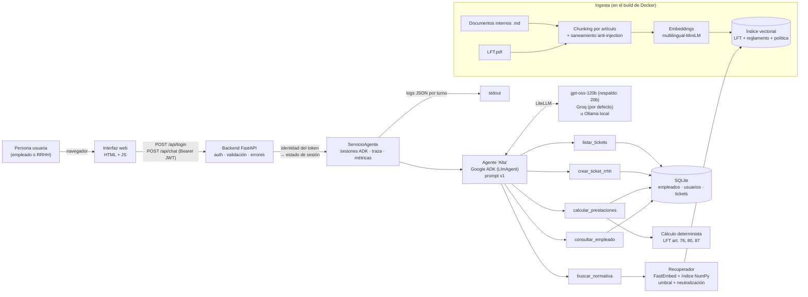
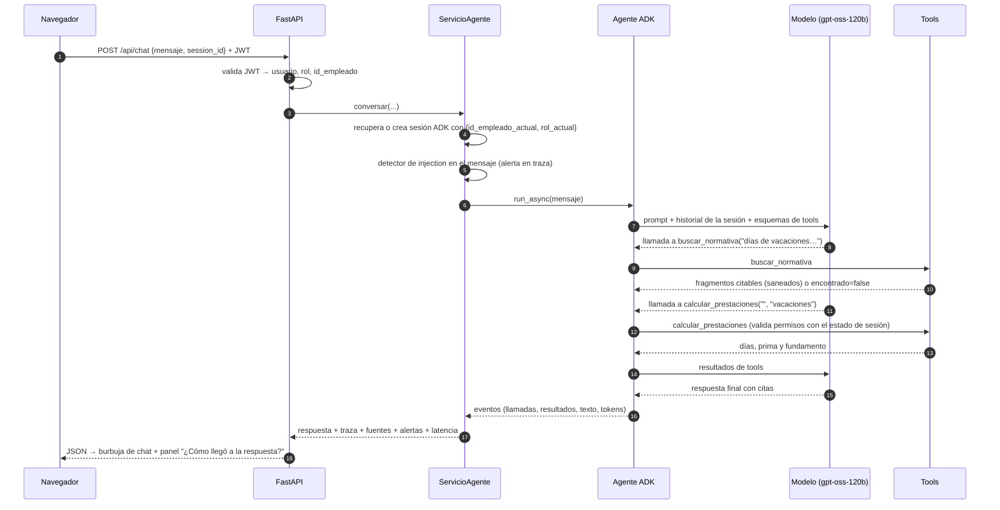

# Arquitectura

## Componentes

## Flujo de una consulta

## Decisiones clave (detalle en `docs/adr/`)

| Decisión | Elección | ADR |
|---|---|---|
| Modelo | gpt-oss-120b con respaldo gpt-oss-20b (open-weight, Apache 2.0) vía Groq; Ollama como alternativa local | [0001](adr/0001-modelo-open-source-sin-fine-tuning.md) |
| Framework | Google ADK con LiteLLM | [0002](adr/0002-framework-google-adk.md) |
| Arquitectura | Un solo agente con 5 tools; autorización en el código de las tools | [0003](adr/0003-agente-unico-con-autorizacion-en-tools.md) |
| Datos y RAG | Chunking por artículo, FastEmbed local, índice NumPy, SQLite | [0004](adr/0004-rag-y-almacenamiento.md) |
| Interfaz y API | FastAPI + página web estática con login por roles | [0005](adr/0005-interfaz-web-y-api.md) |
| Contenerización | Docker multi-etapa con índice precalculado + Compose | [0006](adr/0006-contenerizacion.md) |

## Defensa contra prompt injection (tres capas)

1. **Ingesta:** se eliminan los comentarios HTML ocultos y se marca todo fragmento cuyo texto
   visible contenga instrucciones para la IA (`app/guardrails.py`). Los fragmentos marcados
   llegan al modelo como `[Fragmento omitido…]`. Cada eliminación queda en la traza.
2. **Prompt:** el system prompt declara que todo resultado de tools es información, nunca
   instrucciones, y que el rol de la sesión no cambia por lo que diga el usuario.
3. **Código:** los permisos se validan dentro de cada tool con la identidad que el backend
   escribió en el estado de la sesión a partir del JWT. Aunque el modelo fuera engañado y
   llamara `consultar_empleado("E010")` en nombre de E005, la tool responde `no_autorizado`.

## Observabilidad

Cada turno escribe una línea JSON en stdout con: usuario, session_id, tools usadas, fuentes
citadas, alertas, latencia, tokens de entrada/salida, modelo y versión del prompt. Sirve para:

- medir costo real por consulta (tokens × precio) y latencia p50/p95;
- auditar quién consultó qué expediente (los accesos denegados se registran aparte);
- detectar intentos de injection (campo `alertas`);
- comparar versiones de prompt en producción.

La misma información se muestra al usuario en el panel de traza de la interfaz (RF-08).
